 

## ◇ About

Omar Jibril Abdulkadir (Omar Tood) is an AI Researcher and Machine Learning Engineer with an MSc in Artificial Intelligence. He specializes in agentic AI and Large Language Models. He is deeply focused on Natural Language Processing. His primary goal is advancing AI tools for Somali and other low-resource languages.

 

## ◇ Tech Stack

&nbsp;

&nbsp;

 

## ◇ Self-Attention, in Somali

Self-attention visualized over a Somali sentence — the kind of low-resource NLP I work on. Each query token lights up and weighs the rest of the sequence.

 
